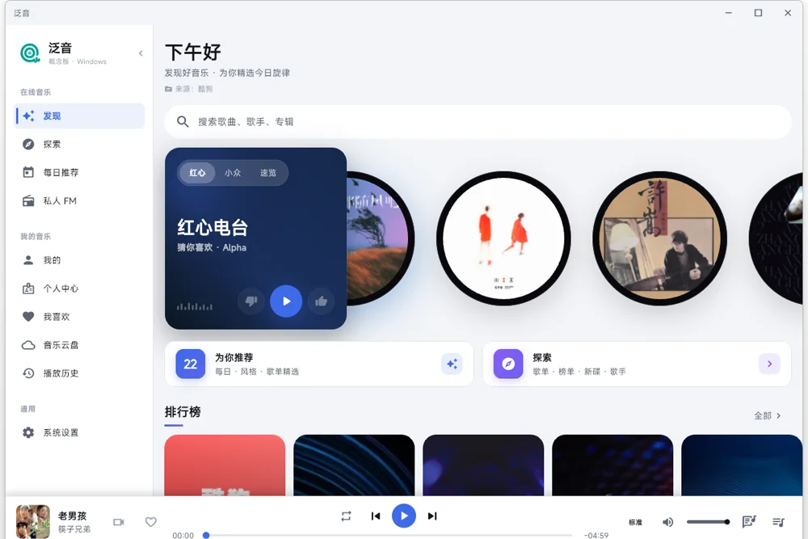
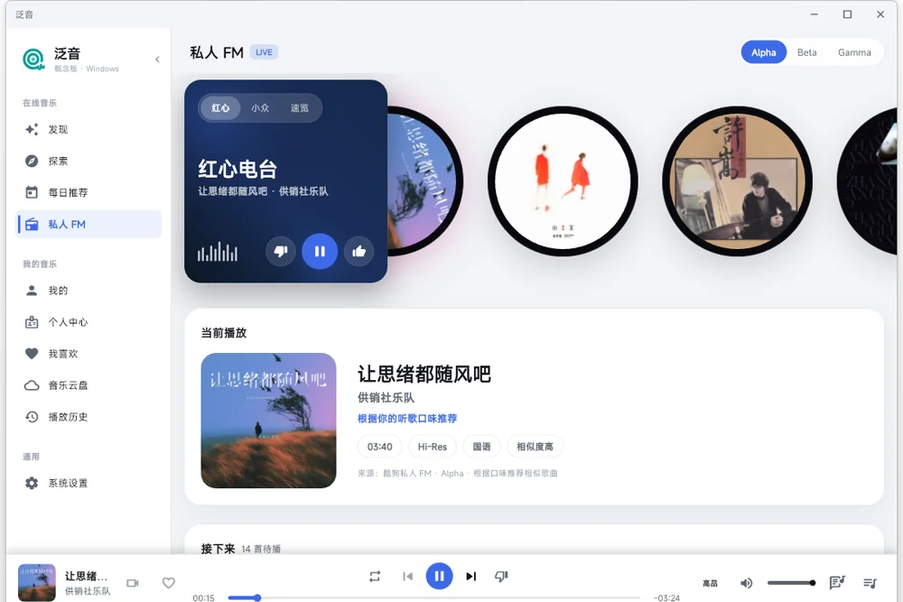
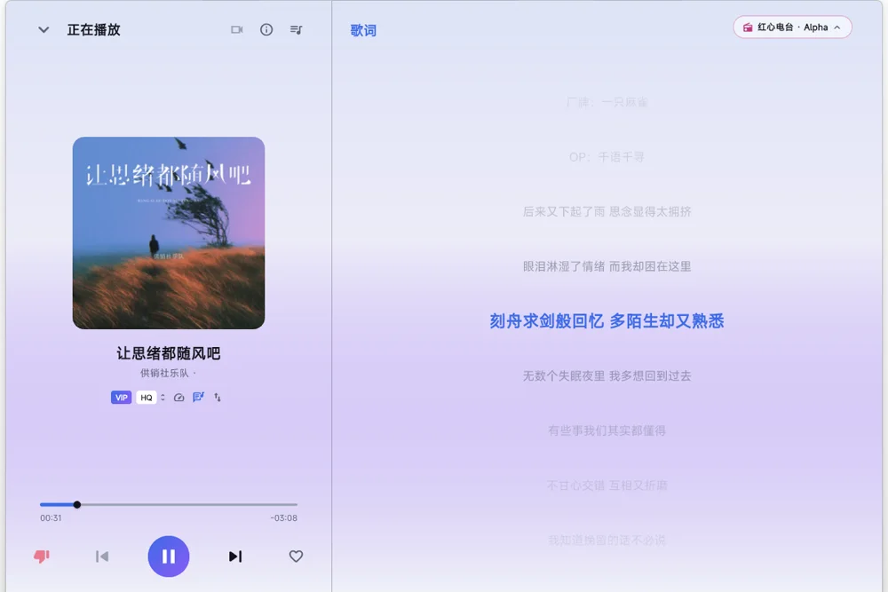
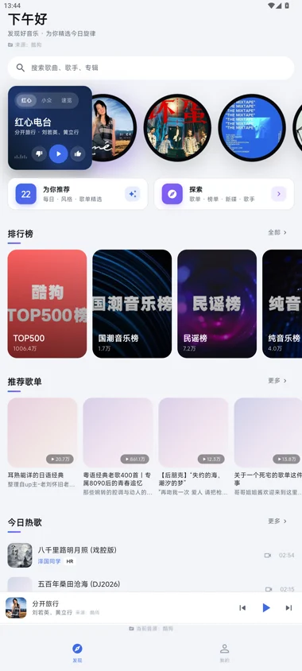
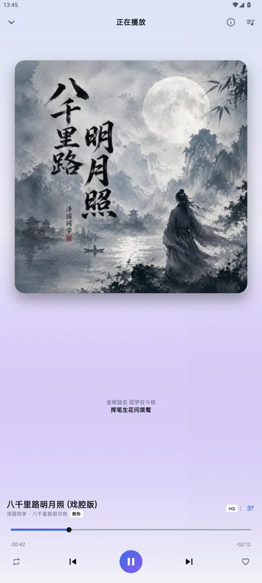

<div align="center">


<h1>泛音 Overtone</h1>

<p>多音源第三方 Flutter 音乐客户端 · 酷狗 / 网易云 / 哔哩哔哩</p>
<p>个人学习与研究向项目，与各音乐平台无关联</p>

<p>
  <a href="https://github.com/ZhengHaoF/overtone/releases"></a>
  <a href="LICENSE"></a>
  
  
</p>

<p>
  <a href="#下载"><b>下载</b></a> ·
  <a href="#功能">功能</a> ·
  <a href="#快速开始">构建</a> ·
  <a href="#文档">文档</a>
</p>

</div>

## 界面预览

| 桌面 · 发现 | 桌面 · 私人 FM | 桌面 · 播放页 |
| :---: | :---: | :---: |
|  |  |  |

| 移动 · 发现 | 移动 · 播放页 |
| :---: | :---: |
|  |  |

> 截图来自 v0.1.x 开发版，默认皮肤；设置 →「实验UI」可切换瑞士国际排版 / MAGI 战术终端两套实验皮肤。

## 功能

### 音源能力

| 能力 | 酷狗 | 网易云 | 哔哩哔哩 |
| --- | :---: | :---: | :---: |
| 搜索 / 取流播放 | 支持 | 支持 | 支持 |
| 扫码登录 | 支持 | 支持 | 待真机验收 |
| 我喜欢 / 收藏 | 支持 | 支持 | 只读收藏夹 |
| 评论读写 | 支持 | 支持 | — |
| 歌词 | 逐字 | 逐字 | — |
| MV | 全链路 | 详情 + 取流 | — |
| 音乐云盘 | 支持 | — | — |

新装默认只启用酷狗，网易云登录后自动并入，哔哩哔哩需在设置中手动开启。

### 播放与内容

| 模块 | 能力 |
| --- | --- |
| 发现 | 每日推荐 · 排行榜 · 为你推荐 · 歌单广场 |
| 搜索 | 歌曲 / 歌单 / 专辑 / 歌手 / MV 五 Tab，三源混排 |
| 播放 | 队列 / 历史 / 倍速 0.5x–2.0x / 杀进程恢复 · Android 通知栏与锁屏 · Windows 桌面壳 |
| 歌词 | LRC 逐行 · 逐字着色 · 译文 / 音译 · 时间偏移 |
| 桌面歌词 | Windows 双进程窗 · Android 悬浮窗 · Linux X11 悬浮窗 |
| 评论 | 歌曲 / 歌单 / 专辑读写 · 楼层 · 筛选 · 网易点赞 · 热搜 |
| MV | 酷狗多版本 / 弹幕 / 小窗 / 画中画 · 网易详情 + 取流 |
| 云盘 | 酷狗音乐云盘：列表 / 播放 / 删除 / 上传匹配 / 秒传 |
| 桌面集成 | SMTC · 托盘 · Thumbar · 任务栏进度 · 窗口位置记忆 |
| 主题 | 默认 / 瑞士国际排版 / MAGI 战术终端，全站热切换 |

### 尚未完成

- 自建歌单 CRUD、分享
- 网易云 MV 搜索、收藏
- 哔哩哔哩真实账号登录与 Android / Windows 真机验收；暂无歌词、评论与写操作
- Windows 桌面歌词为不透明 / 半透明卡片（透明背景实测无解），Wayland 全局悬浮歌词暂缓
- 酷狗云盘上传在凭据防护调整为 HTTPS 后需重新实网验收

## 快速开始

固定验证环境：Flutter 3.47.7 / Dart 3.13.5，Android SDK API 24+。

```bash
cd app
flutter pub get
flutter run
```

构建发行包：

```bash
flutter build apk --release        # Android
flutter build windows --release    # Windows
flutter build linux --release      # Linux（源码构建）
```

质量检查：`flutter analyze && flutter test`。更多工程说明见 [app/README.md](app/README.md)。

## 下载

从 [GitHub Releases](https://github.com/ZhengHaoF/overtone/releases) 获取已发布版本：

- **Android**：arm64-v8a / armeabi-v7a / x86_64 三种 APK，使用正式密钥签名
- **Windows x64**：安装程序，或完整绿色 ZIP（解压后运行 `overtone.exe`，需保留 DLL 与 `data/`）

发布包由 GitHub Actions 手动构建：默认只生成 Actions 附件，勾选 `publish` 才发布正式 Release。Windows 包未配置 Authenticode 代码签名，系统可能出现安全提示。签名配置、验收边界与产物清单见 [交付说明](docs/release-packaging.md)。

## 文档

| 文档 | 内容 |
| --- | --- |
| [设计方案](docs/设计方案.md) | 产品定位、架构、功能范围与实现对照 |
| [多音源接入方案](docs/多音源接入方案.md) | `MusicSource` 契约、三源装配与阶段规划 |
| [实验UI接入规范](docs/实验UI接入规范.md) | 皮肤架构与新增一套实验 UI 的步骤 |
| [api-notes](docs/api-notes.md) | 接口与网络说明（含 MV / 云盘协议） |
| [网易云接口文档](docs/网易云接口文档.md) | 网易云接口清单与实测状态 |
| [哔哩哔哩接入方案](docs/哔哩哔哩接入方案.md) | B 站接入架构与能力差异 |
| [B 站验证记录](docs/bili-integration-validation.md) | 实网验证结果与剩余验收项 |
| [release-packaging](docs/release-packaging.md) | Android 签名 APK、Windows 安装包 / 绿色包与发布流程 |
| [app/README](app/README.md) | 工程运行与模块结构 |

## 参考项目

接口协议与产品形态参考了以下开源项目，仅对齐接口行为 / 借鉴架构思路，未复制业务代码；版权归各作者所有。

<details>
<summary>协议、产品参考与关键代码索引</summary>

### 协议与接口

| 项目 | 用途 |
| --- | --- |
| [MakcRe/KuGouMusicApi](https://github.com/MakcRe/KuGouMusicApi) | 酷狗概念版接口协议（歌曲 / 榜单 / MV / 云盘 / 弹幕等 module） |
| [Binaryify/NeteaseCloudMusicApi](https://github.com/Binaryify/NeteaseCloudMusicApi) | 网易云 weapi/eapi 接口协议（搜索 / 评论 / 专辑等） |
| [NeteaseCloudMusicApiEnhanced/api-enhanced](https://github.com/NeteaseCloudMusicApiEnhanced/api-enhanced) | 网易云接口增强版，MV 全链路（详情 / 取流 / 收藏 / 榜单） |
| [chaunsin/netease-cloud-music](https://github.com/chaunsin/netease-cloud-music) | 网易云 Golang 实现（NeriPlayer 网易云侧的协议参考） |
| [SocialSisterYi/bilibili-API-collect](https://github.com/SocialSisterYi/bilibili-API-collect) | 哔哩哔哩 API 整理（B 站接入评估） |
| [sansenjian/qq-music-api](https://github.com/sansenjian/qq-music-api) | QQ 音乐接口（NeriPlayer QQ 音乐侧参考） |

### 产品与实现

| 项目 | 用途 |
| --- | --- |
| [hoowhoami/EchoMusic](https://github.com/hoowhoami/EchoMusic) | 桌面端酷狗第三方客户端（产品形态 / 云盘 / MV 弹幕 / 本地服务架构） |
| [cwuom/NeriPlayer](https://github.com/cwuom/NeriPlayer) | 多源 Android 播放器（网易云 / B 站 weapi 链路、扫码登录、歌词匹配） |
| [992359133/MoeKoeMusic](https://github.com/992359133/MoeKoeMusic) | 酷狗第三方客户端（云盘码率档等字段口径对照） |

### 关键代码索引

| 能力 | 参考来源 |
| --- | --- |
| 酷狗取流 / 防盗链 | [MakcRe/KuGouMusicApi](https://github.com/MakcRe/KuGouMusicApi) · [hoowhoami/EchoMusic](https://github.com/hoowhoami/EchoMusic) |
| 酷狗 MV 详情 / 取流 / 弹幕 | [MakcRe/KuGouMusicApi](https://github.com/MakcRe/KuGouMusicApi) · [hoowhoami/EchoMusic](https://github.com/hoowhoami/EchoMusic) |
| 酷狗云盘 | [MakcRe/KuGouMusicApi](https://github.com/MakcRe/KuGouMusicApi) · [hoowhoami/EchoMusic](https://github.com/hoowhoami/EchoMusic) |
| 网易 weapi/eapi 加密 | [cwuom/NeriPlayer](https://github.com/cwuom/NeriPlayer) · [Binaryify/NeteaseCloudMusicApi](https://github.com/Binaryify/NeteaseCloudMusicApi) |
| 网易请求形态 / Cookie 合并 | [cwuom/NeriPlayer](https://github.com/cwuom/NeriPlayer) `core/api/netease/NeteaseClient` |
| 网易扫码登录 | [cwuom/NeriPlayer](https://github.com/cwuom/NeriPlayer) `NeteaseQrLoginClient`（chainId / scanlogin URL / 803 实机走通） |
| 网易歌词 YRC 逐字 | [cwuom/NeriPlayer](https://github.com/cwuom/NeriPlayer) `NeteaseYrcParser` |
| 网易用户歌单 / 我喜欢分流 | [cwuom/NeriPlayer](https://github.com/cwuom/NeriPlayer)（`subscribed == true` = 收藏，`specialType == 5` = 我喜欢的音乐） |
| 网易 MV（详情 / 取流 / 收藏） | [NeteaseCloudMusicApiEnhanced/api-enhanced](https://github.com/NeteaseCloudMusicApiEnhanced/api-enhanced) |
| 网易评论 | [Binaryify/NeteaseCloudMusicApi](https://github.com/Binaryify/NeteaseCloudMusicApi) |
| B 站搜索 / 取流 | [cwuom/NeriPlayer](https://github.com/cwuom/NeriPlayer) · [SocialSisterYi/bilibili-API-collect](https://github.com/SocialSisterYi/bilibili-API-collect) |

**对齐基准**：网易云侧以 `cwuom/NeriPlayer` 的 `core/api/netease/` 为基准（本地 checkout 路径见《网易云接口文档.md》页首），`chaunsin/netease-cloud-music` 是它的上游协议参考。

**参考实现的边界**（以下各项未被参考实现覆盖，是本仓自研，勿当成「已对齐」）：

- 网易评论 / 热搜：不在 NeriPlayer `core/api/netease/` 内，照 `Binaryify/NeteaseCloudMusicApi`（`module/comment_new.js` / `module/search_hot.js`）自研。
- B 站评论、红心 / 收藏夹写入、UP 主搜索、音乐向榜单：NeriPlayer 未实现，本仓同样未做，能力矩阵见《哔哩哔哩接入方案.md》。

</details>

## 第三方素材

EVA 红 / EVA 蓝皮肤的视觉语言（配色、终端排版、警示带与角色线稿）参考自 [seaison/dsh-plugin-eva-theme](https://github.com/seaison/dsh-plugin-eva-theme)。该仓库代码为 MIT，但**素材不在 MIT 范围内**。

| 本地文件 | 来源 | 本项目做了什么 |
| --- | --- | --- |
| `app/assets/magi_emblem.png` | NERV 标志 | 作为皮肤水印叠加，未随代码许可 |
| `app/assets/eva/asuka_portrait.png` | 参考项目的明日香半身线稿（维护者用图像生成制作） | 等比缩放到 640px、按皮肤主色染色、17% 透明度叠加 |
| `app/assets/eva/rei_portrait.png` | 参考项目的绫波丽半身线稿（同上） | 等比缩放到 640px、按皮肤主色染色、19% 透明度叠加 |

EVA 角色形象、NERV 标志等权利归其各自权利人（khara 等），本项目与其无关联；上述素材仅用于个人学习与同人风格演示，不构成商业分发。

## 合规声明

本项目为个人学习 / 研究用途的第三方客户端，不提供音频中转或云端账号托管。请遵守当地法律与目标平台服务条款；应用名「泛音」与各音乐平台无关联。

License: MIT（见 [LICENSE](LICENSE)）；第三方素材不在该许可内。
